# Self-Hosted Local AI Stack

A practical, local-first AI workstation built around **Open WebUI + llama.cpp**, with web search, RAG, Jupyter code execution, image generation, text-to-speech, and an optional system-monitoring dashboard.

The goal of this repository is not to provide a generic cloud AI server. It is a reproducible example of how to assemble a capable private AI environment on a single NVIDIA-equipped workstation.

<a href="docs/screenshots/chat-home.png">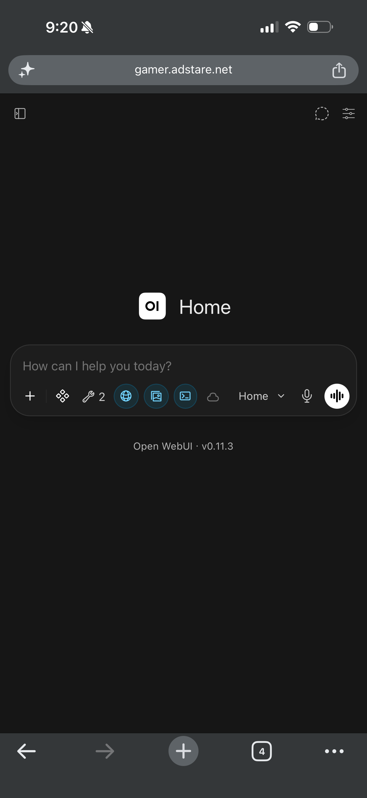</a>

## What it provides

| Component | Purpose |
|---|---|
| **llama.cpp** | Runs a local GGUF language model with an OpenAI-compatible API |
| **Open WebUI** | Main chat interface and orchestration layer |
| **PostgreSQL + pgvector** | Persistent application database and vector storage for RAG |
| **SearXNG** | Self-hosted metasearch backend for web search |
| **Playwright** | Loads JavaScript-heavy pages for the web loader |
| **Apache Tika** | Extracts text from PDFs, Office files, and other documents |
| **JupyterLab** | Code execution and notebook-based analysis |
| **ComfyUI** | Local image generation |
| **Kokoro** | Local text-to-speech |
| **Open Terminal** | Gives Open WebUI a shell and filesystem interface |
| **GitLab MCP** | Lets the model work with issues, merge requests, repos, and pipelines on your GitLab |
| **Sparkboard** *(optional)* | Local system, storage, container, and AI activity monitoring |
| **Avatar** *(optional)* | Talking 3D head in the browser. Built on [LAM](https://github.com/aigc3d/LAM), it uses llama.cpp, Kokoro, Speaches and LAM Audio2Expression for lip-sync |

Everything runs through Docker Compose and communicates over the private Compose network unless a port is intentionally published.

## Architecture

<a href="docs/diagrams/architecture-stack.png">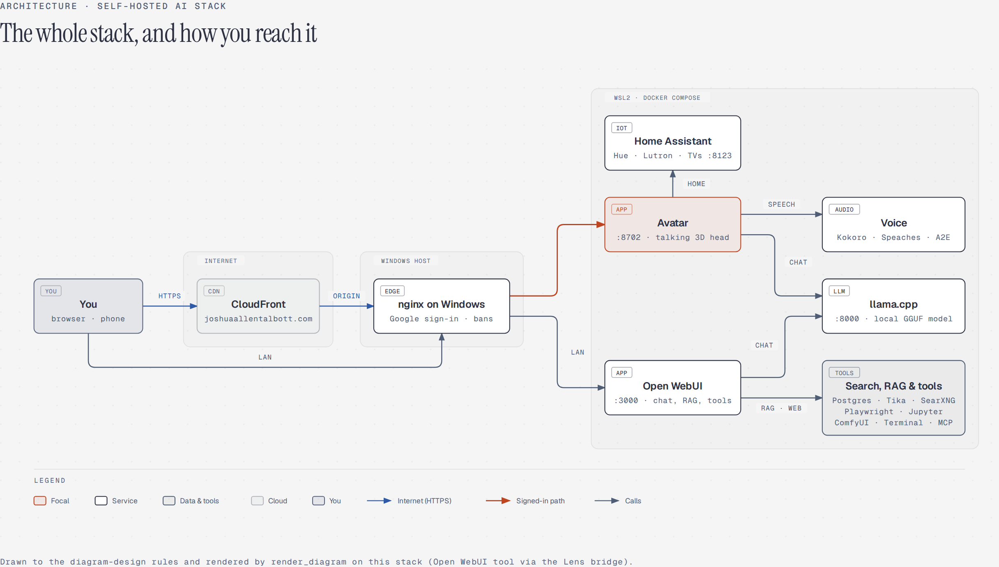</a>

From outside, `joshuaallentalbott.com` goes through CloudFront to nginx on the Windows host, which asks for a Google sign-in (oauth2-proxy, with authgate banning brute-force attempts); on the LAN, nginx lets you straight in. Open WebUI and the avatar share one local llama.cpp model and the voice services. Open WebUI also uses Postgres/pgvector for RAG, Tika to read documents, SearXNG and Playwright for web search, Jupyter for code, ComfyUI for images, Open Terminal and the GitLab MCP server. Sparkboard (optional) monitors the machine.

<a href="docs/diagrams/architecture-avatar.png">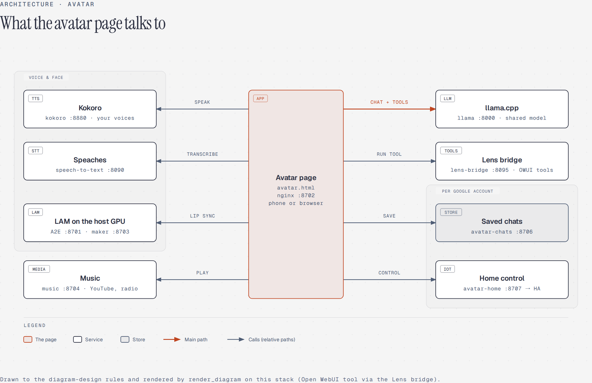</a>

The avatar page reaches everything through relative paths on its own nginx (`:8702` on the LAN, `/avatar/` behind the public nginx), so the browser never makes a cross-origin call. Saved chats and home control are kept per Google account, from the sign-in.

<sub>Both diagrams were drawn to the rules of the stack's own diagram-design tool and rendered by its `render_diagram` function on this stack (an Open WebUI tool, run through the Lens bridge). Sources: [stack](docs/diagrams/architecture-stack.html), [avatar](docs/diagrams/architecture-avatar.html), and the [generator](docs/diagrams/generate.py) that lays them out on the tool's 4px grid.</sub>

## Hardware expectations

This configuration is tuned around a workstation-class NVIDIA GPU and a model that can use system RAM for MoE experts.

### Reasonable starting point

- NVIDIA GPU with **12 GB+ VRAM**
- **64 GB+ system RAM** recommended for the included 35B MoE configuration
- SSD/NVMe storage
- Linux or Windows 11 + WSL2
- NVIDIA Container Toolkit
- Docker Engine + Docker Compose

The included llama.cpp command uses:

```text
-ngl 99
--n-cpu-moe 999
```

That intentionally keeps GPU-resident work on the GPU while allowing MoE expert weights to live in system RAM. This makes a substantially larger model practical on a GPU with limited VRAM, at the cost of additional system-memory use and lower performance than a model that fits entirely in VRAM.

If your machine has less RAM or VRAM, use a smaller GGUF and adjust the llama.cpp command accordingly.

## Prerequisites

### Linux

Install:

1. NVIDIA driver
2. NVIDIA Container Toolkit
3. Docker Engine
4. Docker Compose

Verify GPU access:

```bash
docker run --rm --runtime=nvidia --gpus all ubuntu nvidia-smi
```

### Windows + WSL2

Use:

- Windows 11
- WSL2
- Ubuntu
- NVIDIA driver installed on Windows
- NVIDIA Container Toolkit inside WSL
- Docker Engine inside WSL

Docker Desktop is not required for this configuration.

These commands, run inside the WSL Ubuntu shell, install Docker Engine and the NVIDIA Container Toolkit:

```bash
curl -fsSL https://get.docker.com | sudo sh
sudo usermod -aG docker $USER

curl -fsSL https://nvidia.github.io/libnvidia-container/gpgkey \
  | sudo gpg --dearmor -o /usr/share/keyrings/nvidia-container-toolkit-keyring.gpg
curl -s -L https://nvidia.github.io/libnvidia-container/stable/deb/nvidia-container-toolkit.list \
  | sed 's#deb https://#deb [signed-by=/usr/share/keyrings/nvidia-container-toolkit-keyring.gpg] https://#g' \
  | sudo tee /etc/apt/sources.list.d/nvidia-container-toolkit.list
sudo apt-get update && sudo apt-get install -y nvidia-container-toolkit
sudo nvidia-ctk runtime configure --runtime=docker
sudo systemctl restart docker
```

Close and reopen the WSL shell so the `docker` group membership takes effect, then check GPU access:

```bash
docker run --rm --gpus all nvidia/cuda:12.8.0-base-ubuntu24.04 nvidia-smi
```

To have the stack come back after a reboot, enable systemd in WSL (`/etc/wsl.conf` needs `systemd=true` under `[boot]`) and start Docker at boot:

```bash
grep -A1 '\[boot\]' /etc/wsl.conf
sudo systemctl enable docker containerd
```

Every service in `docker-compose.yaml` uses `restart: unless-stopped`, so the containers start again with Docker.

## Install

Clone the repository:

```bash
git clone <repository-url>
cd Self-hosted-AI-Stack
```

Create the directories used by the Compose file:

```bash
mkdir -p models comfy comfy-models notebooks searxng
```

The Compose file deliberately uses **relative paths** rather than a machine-specific `/home/...` path. This keeps the repository portable between machines and users.

### Download a model

The included configuration expects:

```text
models/Qwen3.6-35B-A3B-UD-Q4_K_XL.gguf
models/mmproj-F16.gguf
```

For example:

```bash
pip install -U "huggingface_hub[cli]"

hf download unsloth/Qwen3.6-35B-A3B-GGUF \
  Qwen3.6-35B-A3B-UD-Q4_K_XL.gguf \
  mmproj-F16.gguf \
  --local-dir ./models
```

You can use another GGUF model, but update the `-m` argument in `docker-compose.yaml`.

### Configure secrets

Copy the example:

```bash
cp .env.example .env
```

Generate strong random values:

```bash
openssl rand -hex 32
```

Use separate values for:

- `POSTGRES_PASSWORD`
- `WEBUI_SECRET_KEY`
- `JUPYTER_TOKEN`
- `OPEN_TERMINAL_API_KEY`

Never commit `.env`.

### Configure SearXNG

Create:

```text
searxng/settings.yml
```

with:

```yaml
use_default_settings: true

server:
  secret_key: "replace-with-a-random-secret"
  limiter: false

search:
  formats:
    - html
    - json
```

The `json` format is required for Open WebUI's SearXNG integration.

### Start the stack

```bash
docker compose up -d
docker compose ps
```

Watch the model server:

```bash
docker compose logs -f llama
```

The first startup can take several minutes while images and the model are loaded.

## Open WebUI

Open:

```text
http://localhost:3000
```

The first account created becomes the administrator.

Open WebUI reaches llama.cpp as an OpenAI-compatible connection (**Admin Panel → Connections**):

```text
URL: http://llama:8000/v1
```

<a href="docs/screenshots/connections.png">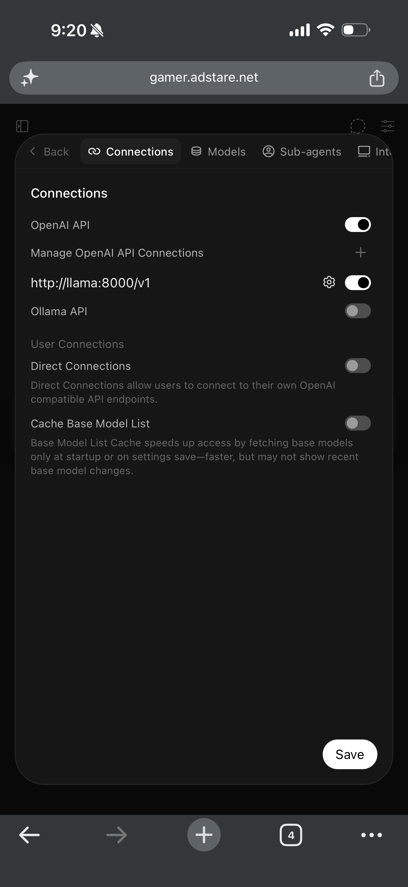</a>

No API key is required for this internal connection. The built-in OpenAI API toggle can stay on with no key set if you don't also want a real OpenAI account wired in.

The model should appear as:

```text
qwen
```

If it does not, check:

```bash
docker compose logs llama
```

Configured models show up under **Admin Panel → Models**:

<a href="docs/screenshots/models.png">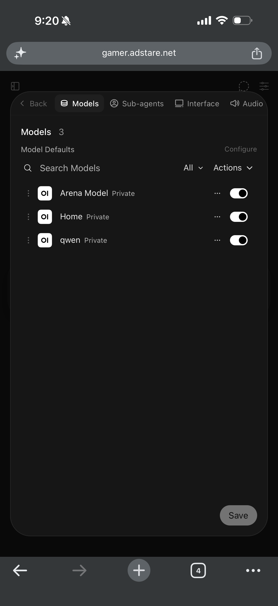</a>

## Open Terminal

Open Terminal is intentionally **not published to the host network**.

In Open WebUI, configure the Open Terminal integration using:

```text
URL:      http://open-terminal:8000
API Key:  value of OPEN_TERMINAL_API_KEY
Auth:     Bearer
```

This component is powerful: it provides a shell/filesystem interface and should be treated as a trusted-user capability.

## GitLab (MCP)

Agent stacks usually connect to systems like GitLab through an **MCP server**: a small service that exposes the GitLab API as tools the model can call. Open WebUI (v0.6.31+) can talk to MCP servers natively over Streamable HTTP, so no extra proxy is needed.

The `gitlab-mcp` service runs the community [zereight/gitlab-mcp](https://github.com/zereight/gitlab-mcp) server. It works with self-managed GitLab and gives the model tools for projects, files, branches, commits, issues, merge requests (including diffs and review comments), and pipelines.

### 1. Create a GitLab token

Create a dedicated GitLab user (e.g. `ai-bot`) and add it as **Developer** only on the projects the assistant should touch. Then create a personal access token for it with the `api` scope (use `read_api` for read-only).

All chats that use the connection act as this one GitLab identity, so its project membership is the real permission boundary.

### 2. Point the service at your instance

Add to `.env`:

```bash
GITLAB_API_URL=https://gitlab.example.com/api/v4
# Optional:
# GITLAB_PERMISSION_MODE=modify     # readonly | modify | full
# GITLAB_TOOLSETS=core              # e.g. core,pipelines,wiki
```

`modify` (the default here) lets the model create branches, commit files, open issues and merge requests, and comment, but blocks delete, cancel, and unprotect tools. Use `readonly` if you only want questions answered.

If your GitLab uses an internal CA, uncomment the `NODE_EXTRA_CA_CERTS` line and the certificate volume in `docker-compose.yaml`.

```bash
docker compose up -d gitlab-mcp
docker compose logs -f gitlab-mcp
```

### 3. Add the connection in Open WebUI

**Admin Panel → Settings → External Tools** (called **Integrations** in newer versions) → **+**:

| Field | Value |
|---|---|
| Type | **MCP (Streamable HTTP)**, not OpenAPI |
| URL | `http://gitlab-mcp:3002/mcp` |
| Auth | Bearer |
| Key | the GitLab token from step 1 |

The token stays in Open WebUI's database, not in `.env`. The server forwards it to GitLab on every request.

### 4. Use it

Enable the GitLab tools on a model (**Workspace → Models → Tools**) or per chat from the **+** menu. Set **Function Calling** to **Native** in the model's advanced parameters; the multi-step tool loop depends on it.

Example prompts:

- "Summarize open merge requests in `group/project` that are waiting on review."
- "Read `src/config.py` on `main` in `group/project`, fix the timeout default, commit it to a new branch, and open a merge request."
- "Why did the latest pipeline on `main` fail? Pull the failing job log."
- "Triage issues labeled `bug` opened this week and comment with a likely cause."

### Notes for local models

Every enabled tool's schema is sent with each request. The `core` toolset is about 40 tools, which a 35B model handles, but adding many toolsets fills context and makes tool selection less reliable. Add toolsets (`pipelines`, `wiki`, `milestones`, …) only as you need them.

The MCP server works through the GitLab API, which suits issues, MRs, reviews, pipelines, and small file edits. For changes that need a real checkout (multi-file refactors, running tests before pushing), have the model use **Open Terminal** with `git` and GitLab's [`glab`](https://gitlab.com/gitlab-org/cli) CLI instead: clone, edit, test, push, then `glab mr create`.

## Web search

Open WebUI is configured to use:

```text
SearXNG → Playwright
```

The important internal endpoints are:

```text
http://searxng:8080
ws://playwright:3000
```

If web search returns nothing, verify that SearXNG has JSON enabled.

### Admin panel reference values

**Admin Panel → Web Search**

<a href="docs/screenshots/web-search-general.png">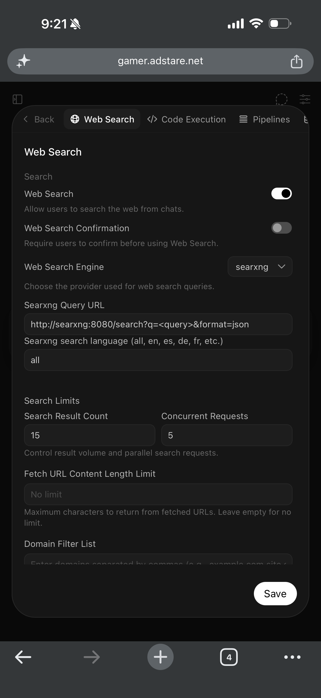</a>
<a href="docs/screenshots/web-search-loader.png">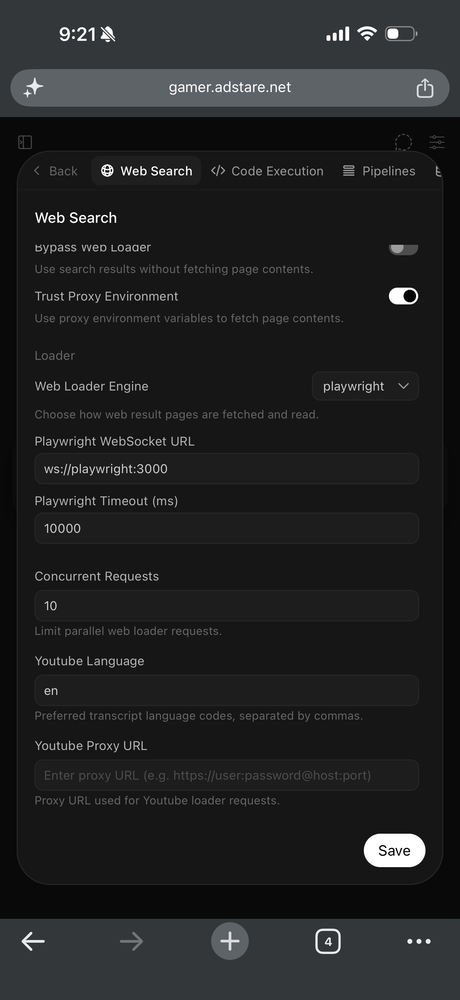</a>

| Setting | Value |
|---|---|
| Web Search | On |
| Web Search Confirmation | Off |
| Web Search Engine | `searxng` |
| Searxng Query URL | `http://searxng:8080/search?q=<query>&format=json` |
| Search Result Count | 15 |
| Concurrent Requests | 5 |
| Web Loader Engine | `playwright` |
| Playwright WebSocket URL | `ws://playwright:3000` |
| Playwright Timeout | 10000 ms |

## RAG and documents

The stack uses:

- Apache Tika for document extraction
- `BAAI/bge-m3` for embeddings
- `BAAI/bge-reranker-v2-m3` for reranking
- PostgreSQL/pgvector for vector storage

Embedding and reranking models are downloaded when first needed.

### Admin panel reference values

**Admin Panel → Documents**

<a href="docs/screenshots/documents-embedding-rag.png">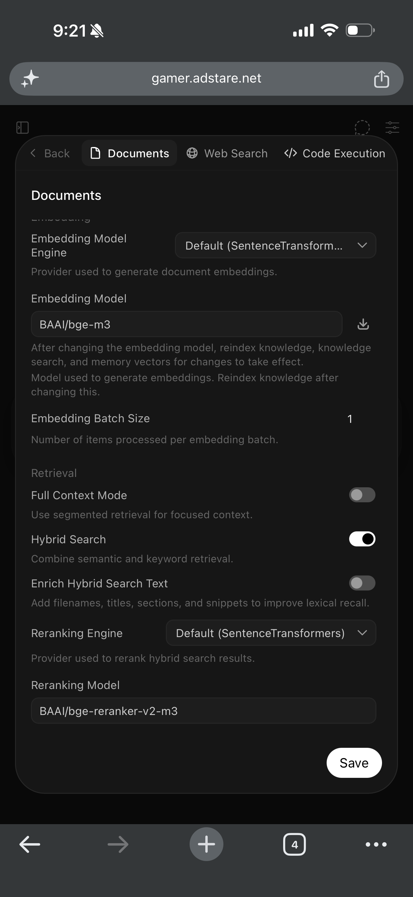</a>
<a href="docs/screenshots/documents-extraction.png">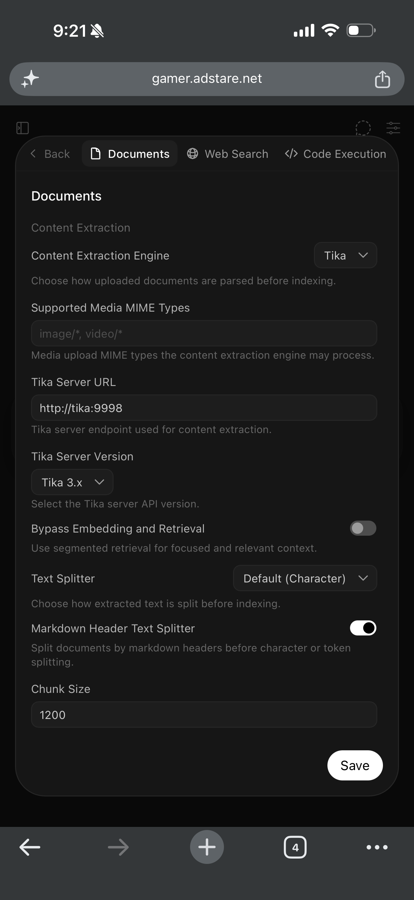</a>

| Setting | Value |
|---|---|
| Content Extraction Engine | Tika |
| Tika Server URL | `http://tika:9998` |
| Tika Server Version | Tika 3.x |
| Text Splitter | Default (Character) |
| Markdown Header Text Splitter | On |
| Chunk Size | 1200 |
| Embedding Batch Size | 1 |
| Hybrid Search | On |
| Enrich Hybrid Search Text | Off |
| Full Context Mode | Off |
| Reranking Engine | Default (SentenceTransformers) |

## Image generation

Open WebUI connects to ComfyUI at:

```text
http://comfyui:8188
```

Put compatible checkpoints under:

```text
comfy-models/checkpoints/
```

ComfyUI itself is available at:

```text
http://localhost:8188
```

### Admin panel reference values

**Admin Panel → Images → Create Image**

<a href="docs/screenshots/image-generation.png">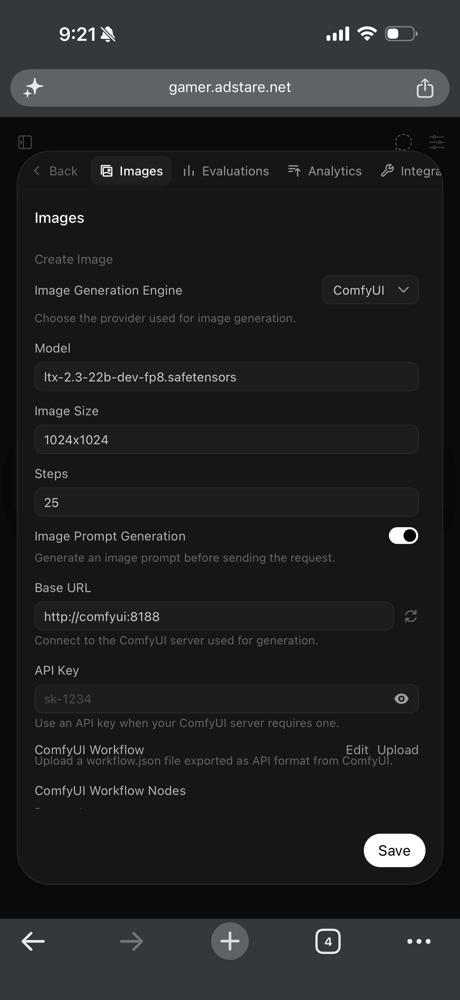</a>

| Setting | Value |
|---|---|
| Image Generation Engine | ComfyUI |
| Base URL | `http://comfyui:8188` |
| Image Size | 1024x1024 |
| Steps | 25 |
| Image Prompt Generation | On |

### Image editing

Open WebUI can also route image *edits* through a separate ComfyUI workflow (**Admin Panel → Images → Edit Image**), pointed at the same `http://comfyui:8188` base URL. After uploading your workflow as API-format JSON under **ComfyUI Workflow**, map the workflow's node IDs to the fields Open WebUI needs to fill in, e.g.:

<a href="docs/screenshots/image-editing.png">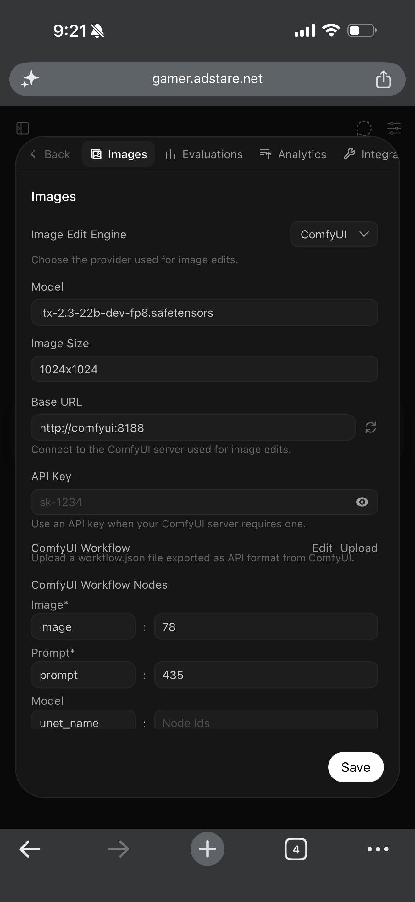</a>

| Field | Workflow input | Node ID |
|---|---|---|
| Image | `image` | 78 |
| Prompt | `prompt` | 435 |
| Model | `unet_name` | set to your checkpoint/unet loader node |

Node IDs are specific to your exported workflow graph and will differ from these.

## Jupyter / code execution

Jupyter is available directly at:

```text
http://localhost:8888
```

Open WebUI is configured to use the internal endpoint:

```text
http://jupyter:8888
```

The notebook directory is:

```text
./notebooks
```

Open WebUI has two places that point at Jupyter and both need the same URL and token: **Admin Panel → Code Execution** (used by the Code Interpreter tool mid-chat) and its **Code Interpreter Engine**, set to `jupyter (Legacy)`.

### Admin panel reference values

**Admin Panel → Code Execution**

<a href="docs/screenshots/code-execution.png">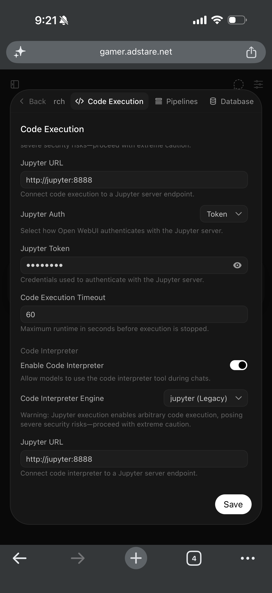</a>

| Setting | Value |
|---|---|
| Jupyter URL | `http://jupyter:8888` |
| Jupyter Auth | Token |
| Jupyter Token | value of `JUPYTER_TOKEN` |
| Code Execution Timeout | 60s |
| Enable Code Interpreter | On |
| Code Interpreter Engine | jupyter (Legacy) |

## Text-to-speech

Open WebUI talks to Kokoro through the OpenAI-compatible TTS API:

<a href="docs/screenshots/text-to-speech.png">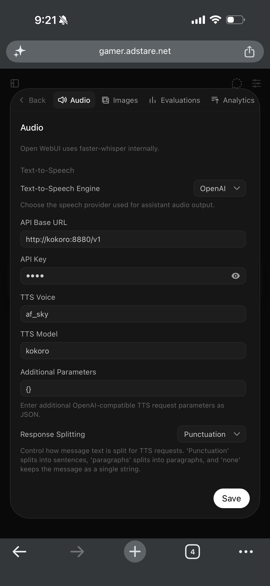</a>

| Setting | Value |
|---|---|
| Text-to-Speech Engine | OpenAI |
| API Base URL | `http://kokoro:8880/v1` |
| TTS Voice | `af_sky` |
| TTS Model | `kokoro` |
| Response Splitting | Punctuation |

Response Splitting controls how message text is chunked before being sent to TTS; Punctuation splits on sentence boundaries rather than sending one long block or splitting by paragraph.

## Diagram Design

`Tools/diagram_design.py` is an Open WebUI tool that adapts the [diagram-design](https://github.com/cathrynlavery/diagram-design) agent skill (MIT, by Cathryn Lavery). The skill draws 45 diagram types, including architecture, flowchart, sequence, state machine, ER, timeline, quadrant, Sankey, and Gantt, as one self-contained HTML + SVG file in a consistent editorial style. Diagrams render inline in the chat.

Open WebUI's own Skills feature takes a single markdown file, and this skill relies on about 60 reference docs and a library of example files, so it is packaged as a tool instead. It gives the model three functions:

| Function | What it does |
|---|---|
| `diagram_guide` | The workflow, the list of 45 types with when to use each, the design rules, and the style tokens |
| `diagram_reference` | The layout rules for one type plus a finished example file to adapt (`light`, `dark`, or `full` variant) |
| `render_diagram` | Runs the skill's self-check, saves the `.html` file, and renders it inline in the chat |

In the chat, each diagram fits the panel width and zooms like an image. It stays vector-sharp at any zoom.

- **Zoom:** pinch, or hold Ctrl/⌘ and scroll. You can also click the diagram and then scroll. Until you click it, scrolling moves the chat as usual.
- **Pan and reset:** drag to pan. Double-click zooms in, and double-clicking again fits the diagram back. The `+`, `−`, and `0` keys work too.
- **Toolbar:** the top-right toolbar has zoom controls, full screen, and downloads as **PNG** (2×), **SVG** (fonts embedded), or the original **HTML** file.

Set the `VIEWER` valve to false to show the plain file instead. The saved file is never modified either way.

### Install

1. Clone the skill next to `docker-compose.yaml`. The compose file mounts it read-only into Open WebUI:

   ```bash
   git clone https://github.com/cathrynlavery/diagram-design
   docker compose up -d openwebui
   ```

   This step is optional. Without a clone, the tool fetches the skill files read-only from GitHub at the ref set in its `GITHUB_REF` valve, and it skips the self-check, which only runs from a local clone. Run `git -C diagram-design pull` to update.

2. In Open WebUI, go to **Workspace → Tools → +**, paste the contents of `Tools/diagram_design.py`, and save.
3. Enable the tool on a model (**Workspace → Models → edit → Tools**) or per chat. Use **Native** function calling for best results.
4. Ask for a diagram in plain words, for example: *"Draw an architecture diagram of this stack: Open WebUI, llama.cpp, Postgres/pgvector, SearXNG, and Jupyter."*

Saved diagrams go to `/app/backend/data/diagrams` inside the container (the `openwebui-data` volume). To copy them out:

```bash
docker cp openwebui:/app/backend/data/diagrams ./diagrams
```

The model writes all of the SVG itself, so output quality depends on the model. The skill's references are long: the guide is about 6k tokens, and a type reference plus its example is another 2–8k, so give the model a context window of at least 32k. If context is tight, lower the `MAX_EXAMPLE_CHARS` valve.

## Avatar

`avatar/` is an optional browser app with a talking 3D head. The head is made from one photo with [LAM (Large Avatar Model)](https://github.com/aigc3d/LAM) from Alibaba's Tongyi Lab. The local LLM writes the reply, Kokoro speaks it, and [LAM_Audio2Expression](https://github.com/aigc3d/LAM_Audio2Expression) turns the audio into lip-sync in real time.

The `avatar` service in `docker-compose.yaml` is an nginx container on port **8702**. It serves `avatar/html/` and proxies llama.cpp, Kokoro, Speaches, the Lens bridge and the Audio2Expression server under one origin, so the page needs no CORS setup. LAM and Audio2Expression themselves run in conda envs on the host, because they compile CUDA extensions against pinned PyTorch and CUDA versions.

Short version, once the conda setup is done:

```bash
bash avatar/scripts/setup-web.sh ~/LAM/output/open_avatar_chat/<name>.zip
docker compose up -d avatar
# then open http://localhost:8702/avatar.html
```

With the optional avatar maker (`avatar/scripts/avatar_maker.py`) running, you can also make new avatars from the page: **Setup → New avatar from a photo** uploads a photo, and LAM turns it into a new head in about a minute. With the `music` service running, you can also ask the avatar to play songs (YouTube), live radio stations or podcasts. Neither the service nor the page needs an account or an API key.

### What it looks like

These are from a phone. The page works the same on a phone as on a desktop browser.

<table>
  <tr>
    <td width="33%">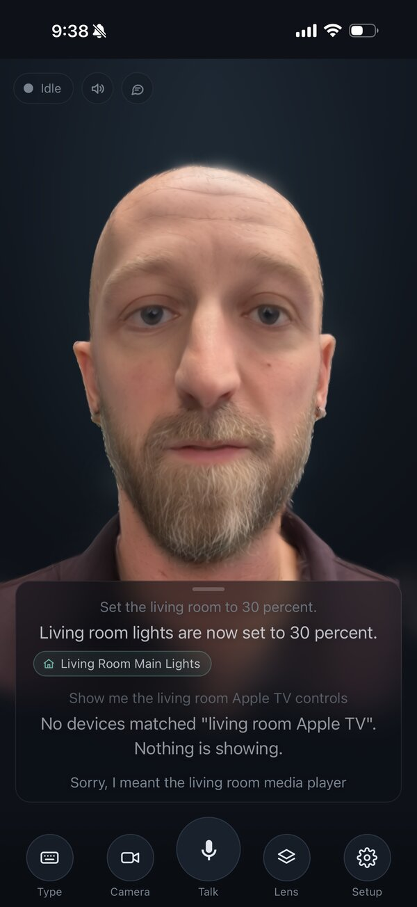</td>
    <td width="33%">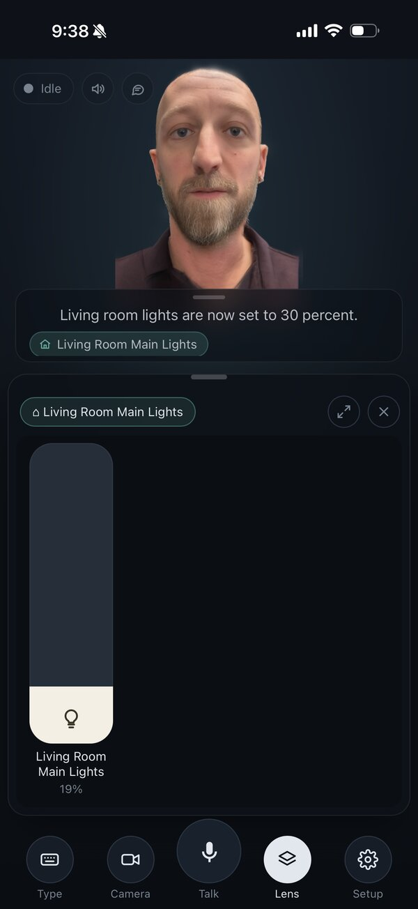</td>
    <td width="33%">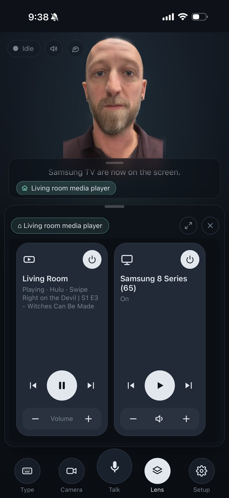</td>
  </tr>
  <tr>
    <td valign="top"><b>Talk or type.</b> The head is lit and lip-synced as it answers. The conversation panel under it keeps each request and reply, and a chip for whatever a reply touched. When nothing matches, the avatar says so, and you can just correct yourself (<i>"Sorry, I meant the living room media player"</i>).</td>
    <td valign="top"><b>Home control.</b> <i>"Set the living room to 30 percent"</i> changes the lights through Home Assistant and opens a Home tab in the Lens with a tall slider for them. Drag it to adjust, or tap to switch them on or off. The face shrinks into the space above the panel.</td>
    <td valign="top"><b>Media controls.</b> Players and TVs get a card with only the controls they support: power, play and pause, previous and next, and volume. The card shows what's playing, here a Hulu episode on the living room player.</td>
  </tr>
</table>

<table>
  <tr>
    <td width="25%">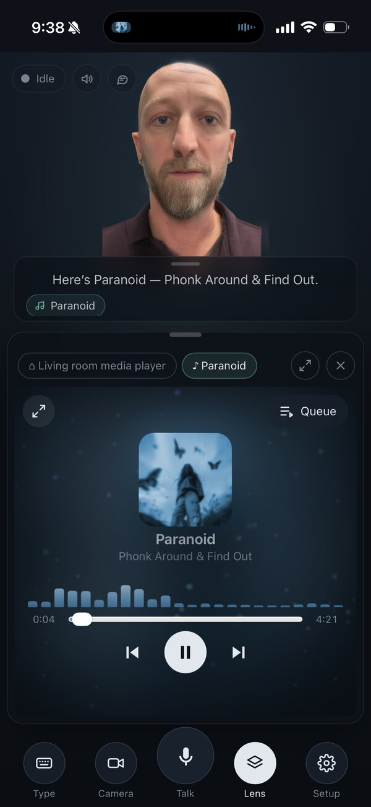</td>
    <td width="25%">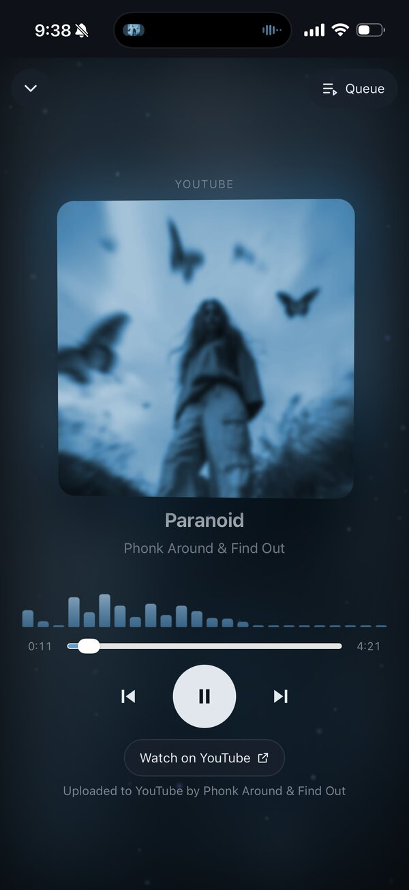</td>
    <td width="25%">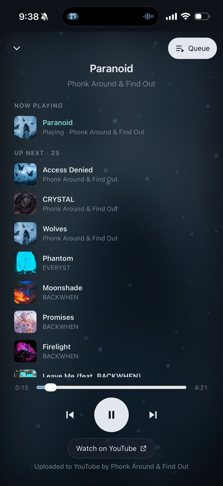</td>
    <td width="25%">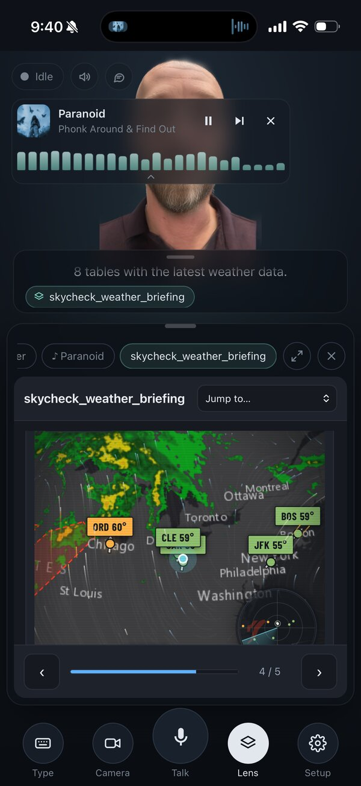</td>
  </tr>
  <tr>
    <td valign="top"><b>Music.</b> Ask for a song and it plays from YouTube, on a <b>♪</b> tab in the Lens with the artwork, a live visualizer, a seek bar and controls. Tabs from earlier requests stay along the top.</td>
    <td valign="top"><b>Full screen.</b> Tap the artwork for a large player, with the source and a link to the original video.</td>
    <td valign="top"><b>Queue.</b> Related songs line up after the one you asked for. Tap any of them to jump to it.</td>
    <td valign="top"><b>Notebook tools in the Lens.</b> Results from Lens bridge tools open as their own tab, here a five-page weather briefing with a radar map, paged with the arrows or <b>Jump to…</b>. The music keeps playing in a mini player above the face.</td>
  </tr>
</table>

**[avatar/README.md](avatar/README.md)** has the full install: the LAM and Audio2Expression conda envs, the version pins and build fixes they need, Blender export, the avatar maker, hosting, troubleshooting, and credits.

## Sparkboard

Sparkboard is an optional monitoring component included as a local project under:

```text
./sparkboard
```

It can monitor:

- CPU and memory
- storage
- running containers
- service state
- historical metrics
- optional AI activity classification

It listens on:

```text
http://localhost:9102
```

Sparkboard uses host `/proc` and the Docker socket for monitoring. Docker socket access is security-sensitive even when mounted read-only, so do not expose Sparkboard directly to an untrusted network.

### WSL storage monitoring

The default Compose configuration includes:

```text
/mnt/c → C:
/mnt/d → D:
```

These mounts are useful under WSL but should be removed or changed for a native Linux installation.

The `DISK_PATHS` environment variable controls the labels shown by Sparkboard.

### What it reports

<a href="docs/screenshots/sparkboard-overview.png">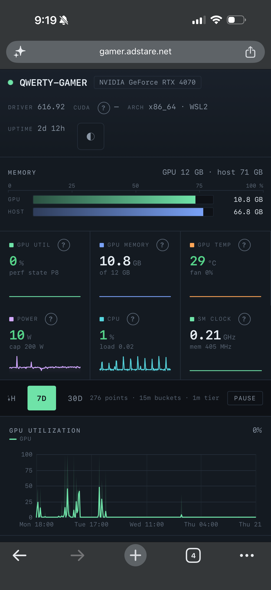</a>

For each container, Sparkboard tracks CPU %, memory (absolute and % of host), and published ports, for example:

<a href="docs/screenshots/sparkboard-containers.png">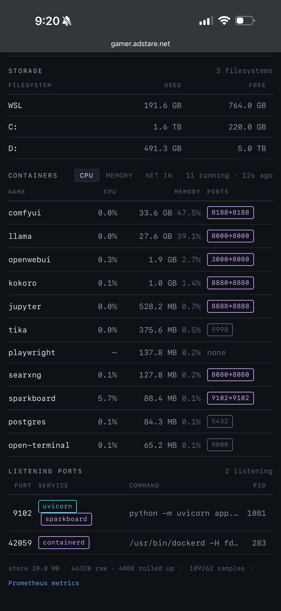</a>

| Container | Published port |
|---|---|
| openwebui | 3000→8080 |
| llama | 8000→8000 |
| comfyui | 8188→8188 |
| kokoro | 8880→8880 |
| jupyter | 8888→8888 |
| searxng | 8080→8080 |
| sparkboard | 9102→9102 |
| avatar | 8702→80 |
| music | 127.0.0.1:8704→8000 (for an nginx outside Compose) |
| tika, playwright, postgres, open-terminal, gitlab-mcp | not published |

On an NVIDIA host it also shows GPU utilization, VRAM allocated, temperature, power draw, and SM/memory clocks over time, plus a per-core CPU load breakdown and network/disk throughput history.

<a href="docs/screenshots/sparkboard-gpu-metrics.png">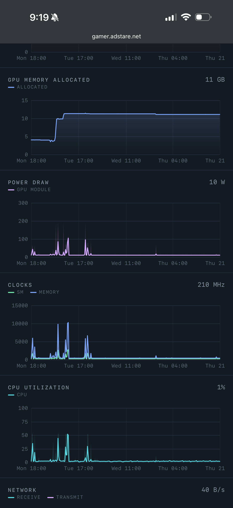</a>
<a href="docs/screenshots/sparkboard-system-load.png">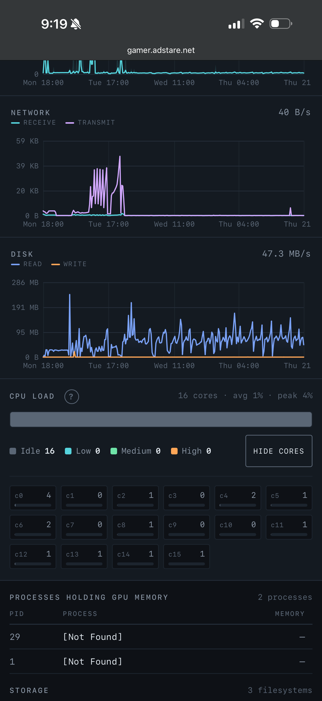</a>

## Ports

| Port | Service | Purpose |
|---:|---|---|
| 3000 | Open WebUI | Main interface |
| 8000 | llama.cpp | OpenAI-compatible model API |
| 8080 | SearXNG | Search interface |
| 8188 | ComfyUI | Image generation UI |
| 8880 | Kokoro | TTS API |
| 8888 | Jupyter | Notebook/code environment |
| 8702 | Avatar | Avatar web app *(optional)* |
| 9102 | Sparkboard | Monitoring dashboard |

Playwright, Tika, PostgreSQL, Open Terminal, and GitLab MCP do not publish host ports.

The LAM Audio2Expression server runs on the host at port 8701, and the optional avatar maker at port 8703, both outside Compose. The `avatar` container reaches it through `host.docker.internal`.

## Security

This is a **single-user / trusted-user stack**, not a hardened multi-tenant platform.

In particular, Open Terminal can provide extremely powerful host/container access. Do not expose it directly to the Internet.

The GitLab MCP connection lets the model write to GitLab as the token's user. Scope that user to specific projects, keep `GITLAB_PERMISSION_MODE` at `modify` or `readonly`, and protect `main` so changes go through merge requests.

Before exposing Open WebUI externally:

- use HTTPS
- use strong authentication
- keep secrets out of Git
- consider binding administrative services to localhost
- understand what host directories are mounted into containers

## Updating

Pull new images:

```bash
docker compose pull
docker compose up -d
```

Your persistent application data is stored in named Docker volumes.

Back up important data before making major image or database-version changes.

## Repository layout

```text
.
├── docker-compose.yaml
├── .env.example
├── .gitignore
├── README.md
├── models/
├── comfy/
├── comfy-models/
├── notebooks/
├── searxng/
├── sparkboard/
└── avatar/
    ├── README.md            LAM / Audio2Expression install and hosting guide
    ├── nginx-avatar.conf    nginx config for the avatar container
    ├── html/                avatar.html, lib/ (renderer), avatars/ (bundles)
    ├── music/               music service: YouTube, radio and podcast search and streaming
    └── scripts/             setup-web.sh, export_avatar.py, a2e_server.py, avatar_maker.py, systemd units
```

Model weights, generated data, secrets, databases, and other machine-specific state should not be committed to Git.

## License

Choose a license appropriate for the code you publish. The repository itself is primarily configuration and integration glue around the respective upstream projects; each upstream component remains subject to its own license and terms.
